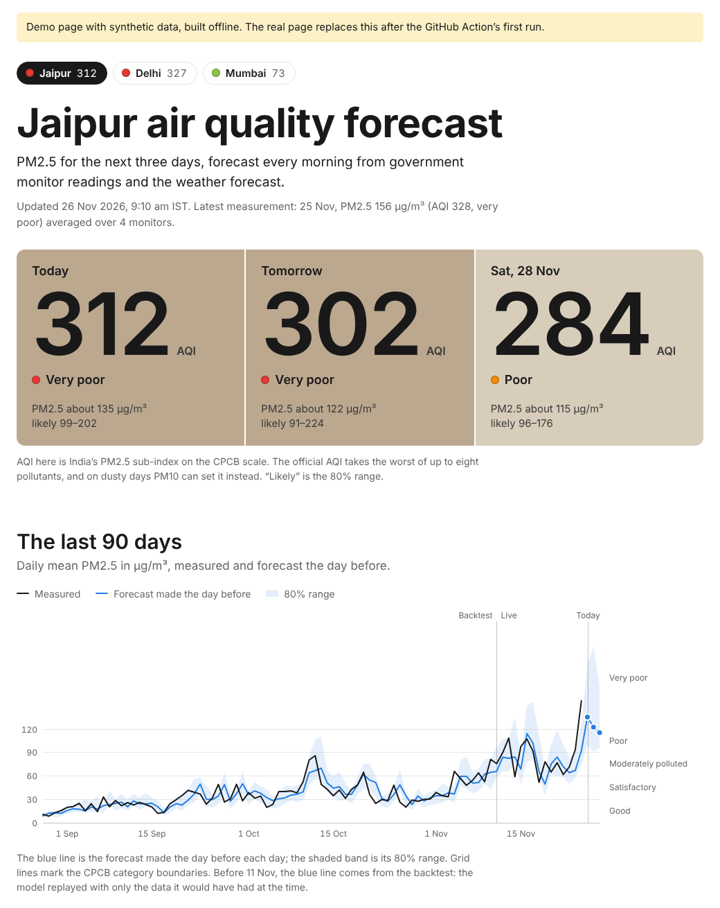
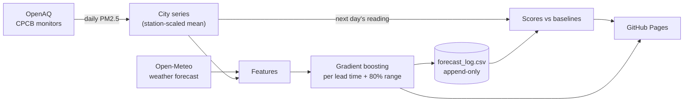

# Air quality forecast for Indian cities

A PM2.5 and AQI forecast for the next three days for Jaipur, Delhi and Mumbai (or any cities you pick). A GitHub Action retrains the models and publishes them every morning. Every forecast is logged before its day happens and then scored against simple baselines, in public.

**Live page:** https://yashvardhan0505.github.io/aqi-forecast/

[](https://github.com/Yashvardhan0505/aqi-forecast/actions/workflows/daily.yml)
[](https://github.com/Yashvardhan0505/aqi-forecast/actions/workflows/tests.yml)


<sub>Screenshot from the offline demo, which uses synthetic data. The live page above shows real forecasts.</sub>

## What it does

Every morning at 09:10 IST a scheduled GitHub Action:

1. Downloads yesterday's PM2.5 from each city's government (CPCB and state board) monitors through the [OpenAQ](https://openaq.org) API, and the latest weather forecast from [Open-Meteo](https://open-meteo.com).
2. Retrains gradient-boosted tree models for each city and forecasts PM2.5 for today, tomorrow and the day after, each with an 80% range.
3. Appends the forecasts to `data/<city>/forecast_log.csv` before those days are measured, and scores the older ones that now have measurements.
4. Commits the data and publishes the pages with GitHub Pages: the forecast, 90 days of forecast against measurement, and accuracy against two baselines. A switcher at the top of the page moves between cities.

If one city's data is unavailable on a given day, the other cities still update, and the run page on GitHub shows a warning for the one that failed.

No server or database is involved. The repository stores the data and GitHub Actions runs the jobs.

## How it works



**Data.** OpenAQ serves each monitor's daily mean (local calendar day, the same convention CPCB uses). Days with fewer than 16 of 24 hours of data are dropped, along with sensor error values. Some monitors read consistently higher than others (a roadside station versus a residential one), so a plain average would jump whenever one went offline. Instead, each monitor is scaled by its typical ratio to the city mean before averaging (`aqi/data.py`). Weather history comes from Open-Meteo's archive of past forecasts rather than reanalysis, so training data looks like what the model sees when it forecasts live.

**Features** (`aqi/features.py`). For a base day *t* and a lead time *h* the features are:

- the last 7 days of log PM2.5, plus 7- and 14-day means, the spread and the 3-day trend
- the value on the same weekday last week
- the weather forecast for day *t+h* (temperature, humidity, rain, wind speed, wind as u/v components, surface pressure, boundary layer height) and how it changes from day *t*
- the day of the year (as sine and cosine) and the day of the week

A test (`tests/test_features.py`) rewrites every PM2.5 value after *t* and checks that none of the features change, so nothing from the future leaks in.

**Model** (`aqi/model.py`). scikit-learn's `HistGradientBoostingRegressor` predicts the *change* in log PM2.5 from day *t* to *t+h* rather than the level. "No change" is persistence, the baseline it has to beat, so the model only has to learn when and how the air will differ from today. Two quantile models (10th and 90th percentiles) give the 80% range. Early stopping on a held-out 15% of the training rows decides how many trees to grow. There is one set of models per city and lead time, retrained on every run.

**Evaluation.** Two baselines: *same as last day* (persistence) and *same as last week*.
- **Live** (`aqi/tracking.py`): the forecast log is append-only. A rerun on the same morning never overwrites a forecast, and the git history shows when each one was written.
- **Backtest** (`aqi/backtest.py`): the last 180 days are replayed, refitting every 14 days on only the data that existed at the time. It's slightly optimistic, because for past days the weather inputs are short-range archive forecasts rather than the 2–3-day-ahead forecasts the live model gets. That's why the page shows live scores once 14 days of forecasts have been measured.

The page reports mean absolute error, the gain over persistence, how often the AQI category is right, and how often the measured value falls inside the 80% range.

**AQI.** India's official AQI is the worst sub-index across up to eight pollutants. This project forecasts PM2.5, which sets the AQI in Jaipur on most winter days, and reports the PM2.5 sub-index on CPCB's scale (capped at 500, which PM2.5 reaches at 380 µg/m³). On dusty days PM10 can set the official number instead.

## Set it up (about 10 minutes)

1. **Create the repo.** Make a new public repository called `aqi-forecast` on GitHub and push this folder to it:
   ```bash
   git init -b main && git add . && git commit -m "AQI forecaster"
   git remote add origin https://github.com/<your-username>/aqi-forecast.git
   git push -u origin main
   ```
   If your username isn't `Yashvardhan0505`, update `repo_url` in `config.toml` and the links at the top of this README.
2. **Get an OpenAQ API key.** It's free: register at https://explore.openaq.org/register and copy the key from your account settings.
3. **Add it as a secret.** Go to the repo's *Settings → Secrets and variables → Actions → New repository secret*. Name it `OPENAQ_API_KEY` and paste the key as the value.
4. **Turn on Pages.** Go to *Settings → Pages → Build and deployment*, and set *Source* to **GitHub Actions**.
5. **Run it once.** Go to *Actions → Daily forecast → Run workflow*. The first run downloads about four years of history for every city and takes 10–15 minutes. After that it runs every morning on its own in a few minutes, and the page appears at `https://<your-username>.github.io/aqi-forecast/`. Each city also has its own address, such as `.../aqi-forecast/delhi/`.

## Run it locally

```bash
python -m venv .venv && source .venv/bin/activate   # Windows: .venv\Scripts\activate
pip install -r requirements.txt -r requirements-dev.txt

python -m pytest -q                 # unit + end-to-end tests, about 30 s, no network needed
python -m aqi demo                  # offline demo, all cities, synthetic data -> demo/docs/index.html

export OPENAQ_API_KEY=your-key      # Windows: set OPENAQ_API_KEY=your-key
python -m aqi run                   # the real daily job
python -m aqi site                  # rebuild the pages from stored data
python -m aqi backtest              # rerun the backtests on stored data
```

The demo runs the real pipeline against fake OpenAQ and Open-Meteo servers (`aqi/demo.py`). They return the same JSON shapes as the real APIs, which makes the demo an end-to-end test of the parsing code as well.

## Choose the cities

Cities are the `[[cities]]` blocks at the top of `config.toml`. The first one is the page at the main link, and the rest appear in the switcher. To add a city, copy a block:

```toml
[[cities]]
name = "Bengaluru"
latitude = 12.9716
longitude = 77.5946
timezone = "Asia/Kolkata"
bbox = [77.45, 12.80, 77.78, 13.15]   # west, south, east, north
```

The box only needs to cover the city's monitors. Take the city centre and add and subtract about 0.2 degrees. If the run says "No PM2.5 monitors found", make the box bigger. A new city downloads its history on the next run; to remove a city, delete its block (its old data stays in `data/<city>/` until you delete that folder). Every city adds to the run time and to the OpenAQ requests (free keys allow 2,000 an hour), so a handful of cities is a sensible limit.

The page uses India's AQI scale, so stick to Indian cities.

## Project layout

```
aqi/
  openaq.py      OpenAQ v3 client: find monitors, download daily means
  weather.py     Open-Meteo client: hourly weather rolled up to IST days
  config.py      reads config.toml: the cities and all settings
  data.py        storage, cleaning, station-scaled city average
  features.py    the learning table (no future leakage)
  model.py       gradient boosting + quantile range per lead time
  backtest.py    rolling-origin backtest
  tracking.py    append-only forecast log and live scoring
  evaluation.py  error metrics shared by backtest and live
  aqi_india.py   CPCB PM2.5 sub-index and categories
  site.py        builds docs/index.html (page.html is the template)
  pipeline.py    the daily job for every city, start to finish
  demo.py        synthetic data and fake API servers for the offline demo
tests/           unit tests and end-to-end runs against the fake servers
data/<city>/     committed data for each city (see data/README.md)
docs/            the published pages: docs/index.html is the first city, docs/<city>/ the rest
```

## Troubleshooting

- **The run fails with `HTTP 401` from OpenAQ.** The `OPENAQ_API_KEY` secret is missing or wrong.
- **"No PM2.5 monitors found inside bbox".** That city's box in `config.toml` doesn't cover any monitors. The order is west, south, east, north. The other cities still update.
- **A yellow warning on the run.** One city failed that day (the warning says which and why); its page keeps the last data it had.
- **The page says "No forecast today".** The newest measurements are more than three days old, so the monitors or OpenAQ are running late, and the next run tries again. If it lasts for weeks, check the stations on https://explore.openaq.org; OpenAQ's feed from CPCB has had gaps before.
- **The deploy job fails.** Pages isn't set to *GitHub Actions* (setup step 4).
- **Scheduled runs stopped.** GitHub pauses scheduled workflows in repos with no activity for 60 days. The daily data commit normally prevents that; if it happens, re-enable the workflow from the Actions tab.

## Ideas for next steps

- Calibrate the 80% range. Quantile models are often overconfident, and the page shows how often the range actually holds; conformal prediction on the live log is a natural fix.
- Add the CAMS PM2.5 forecast (Open-Meteo's Air Quality API) as a feature, so the model learns to correct a physics-based forecast.
- Forecast PM10 as well and report the combined AQI.
- Add a festival feature (Diwali), and probabilistic scores such as pinball loss.
- Forecast each monitor separately and show a map.
- Add a page comparing the cities side by side.

## Credits

Air quality data: CPCB and state pollution control board monitors, via OpenAQ. Weather data by [Open-Meteo.com](https://open-meteo.com/) (CC BY 4.0). Code under the MIT licence. This is a student project, not an official forecast.
